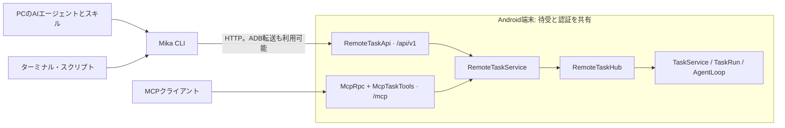

# CLIとスキル: 接続とタスクコマンド

[PCからの利用](computer.md) · [CLIとスキルの導入](computer-install.md) · [MCPでの接続](mcp.md)

CLIとMCPは、スマホ上の同じタスクサービスを使います。CLIは通常のHTTP APIを呼び出すため、MCPのSDK、初期化、ツール一覧取得、クライアント設定は不要です。スキルは、PCのAIエージェントに委任の方法や質問への対応、結果の確認方法を伝えます。実際の計画と操作はスマホ上のMika JPが行います。



導入・更新・削除は[導入ガイド](computer-install.md)を参照してください。スマホにはタスクAPI v1へ対応したMika JPが必要です。このフォークの同じソース版から用意したAPKとPC用ツールを使ってください。

スキルだけを導入した場合、以下の `mika` は `python3 <スキルディレクトリ>/mika/scripts/mika_cli.py` に置き換えます。Windowsでは `python3` を `py -3` にします。

## 接続

### ADBを使う

Android platform-toolsと、USBまたは接続済みの無線ADBが必要です。無線ADBでは、このPC自身がスマホとペア設定・接続済みで、`adb devices` に対象が `device` と表示される必要があります。スマホ内のMikaヘルパーのペア設定とは別です。

```bash
mika devices --json
mika connect --device SERIAL --json
mika doctor --device SERIAL --json
```

オンライン端末が一台だけなら `--device` は省略できます。`ANDROID_SERIAL` も利用できます。複数ある場合は対象を指定してください。接続に失敗しても、別のスマホへ自動では切り替えません。

`connect` はMika JPに同梱された起動スクリプトでコンピューターアクセスを有効にし、必要なヘルパーの起動も試みます。タスクは送信しません。ほかのコマンドは、現在の接続情報を読み取って使います。

各呼び出しで現在のトークン・ポート・起動番号を読み、一時的な `adb forward tcp:0` を割り当て、終了時にその転送だけを解除します。トークンはプロセス内で扱い、起動スクリプトの出力はそのまま表示しません。CLIを終了しても、スマホ側のサービスや実行中のタスクは停止しません。

CLIでは固定ポートの手動転送は不要です。ケーブルを接続し直したら、同じ端末がADBに戻ったことを確認します。スマホを再起動した場合やコンピューターアクセスを無効にした場合は、`connect` を再実行してください。

### Wi-Fi・プライベートVPNを使う

先にスマホの設定でネットワークアクセスを有効にします。

```bash
mika --url http://PHONE:8765 --token-file /path/to/private-token-file doctor --json
```

トークンファイルにはトークンだけを保存します。URLにはサーバーのルート、または `/api/v1` を指定し、`/mcp` は指定しません。ユーザー名やパスワードを含むURLは受け付けません。

CLIはリダイレクトを拒否し、環境変数などのHTTPプロキシを使いません。スマホ側のプライベートネットワーク制限も維持されます。直接のHTTP接続は暗号化されないため、ADBまたは信頼できるプライベートネットワークで利用してください。

<a id="任务命令"></a>
<a id="tasks"></a>

## タスクコマンド

```bash
mika --device SERIAL task run --goal-file task.txt --json
mika --device SERIAL task status TASK_ID --json
mika --device SERIAL task wait TASK_ID --timeout 45 --json
mika --device SERIAL task answer TASK_ID --text-file answer.txt --json
mika --device SERIAL task steer TASK_ID --text "今日のメッセージだけを要約して" --json
mika --device SERIAL task cancel TASK_ID --json
mika --device SERIAL task list --limit 10 --json
```

短い文は `--goal`・`--text`、複数行はUTF-8のファイルを使えます。ファイル引数に `-` を指定すると標準入力から読みます。`run --conversation CONVERSATION_ID` で既存のリモート会話を続けられます。`answer` は現在開いている質問にだけ回答します。従来の `mcp-` で始まる会話IDも共用できます。この接頭辞は、CLIがMCPを使うことを意味しません。

`run` はタスクIDを受け取ると戻ります。`wait` は最大50秒で、状態の変化か終了時に戻ります。すでに質問待ち・スマホ操作待ちなら、すぐその状態を返します。待機時間が切れてもスマホのタスクを失敗扱いにしたり、停止・再送したりしません。

停止要求の `accepted` は受理の通知です。停止したと報告する前に状態を読み、`cancelled` を確認してください。

### 実行中のタスクへ指示を追加する

`steer` は `running` のリモートタスクへ、IDと文脈を保ったまま追加指示を送ります。`--text-file` も使え、`-` なら標準入力です。上限は4000文字です。

`accepted: true` と `message_id` は受信箱へ届いたことを示すだけです。`status` の `steers` で該当IDを確認してください。

| 状態 | 意味 |
| --- | --- |
| `received` | 受信し、取り込み待ち |
| `joined` | タスクの文脈へ取り込み済み。指示の実行成功を意味しない |
| `not_applied` | 終了・停止までに取り込まれなかった |

実行中の操作は先に終わり、追加指示によって過去の操作が取り消されることはありません。待ち行列、一時停止、質問待ち、スマホへの引き継ぎ待ち、終了済みのタスクは追加指示を拒否します（409）。質問には `answer` を、承認・引き継ぎにはスマホを使います。タスク終了と競合しても別タスクを開始しません。

書き込みの応答を失った場合は、自動で繰り返さず、同じタスクを確認してください。`message_id` が得られず到達を確認できない場合は、その不確実さを報告します。追加指示にはスマホの `task_steer` 対応が必要です。非対応の場合はAPKの更新が必要で、新しいタスクへの置き換えは行いません。

### 出力と終了コード

`--json` は成功・失敗とも標準出力にJSONオブジェクトを一つだけ出します。省略時は整形したJSONを表示し、エラーは標準エラー出力へ出します。接続引数と `--json` はサブコマンドの前後どちらにも置けます。`--request-timeout` はHTTPの制限時間で、待機要求では指定した待機時間に加えて最低5秒の受信時間を確保します。

| 終了コード | 意味 |
| --- | --- |
| 0 | 呼び出し成功。タスクの実行中・本人の対応待ち・停止処理中の場合もある |
| 1 | APIによる明示的な拒否、またはタスクの失敗・停止を確認した |
| 2 | 入力、設定、接続、プロトコル互換性の問題 |
| 4 | 書き込み結果が不明。スマホが受理している可能性があり、自動再送していない |
| 130 | PC側の読み取り・待機を中断した。スマホへの停止要求は送っていない |

### 応答を失ったタスクを確認する

`task_recovery` に対応するスマホでは、CLIは送信前に小文字のUUIDを生成し、スマホは開始前に記録します。自動処理ではUUIDを先に保存し、`task run --request-id UUID --goal ...` へ渡せます。応答を失うと終了コード4と `task_id` を返します。同じスマホへ再接続し、`mika task status UUID` で確認してください。

404のままで再試行する場合は、同じID・依頼文・会話引数を使います。同じ依頼の再送は既存タスクを返します。IDを別の依頼に使うと409になります。CLIは書き込みを自動再送しません。

アプリのプロセス再起動後も、同じIDから回答・検証結果・失敗理由・停止状態を取得できます。途中だったタスクは `failed`、`failure_kind=interrupted` になります。会話を削除するとリモートタスクの内容も消え、使用済みIDは410となり再利用できません。

終了済みの記録は30日間、最大で直近1000件です。保持期間・件数を超えたIDは新規の依頼として扱われます。更新前にメモリにしか残っていなかったIDは復元できません。非対応のスマホでも従来の通常送信と最近のタスクの参照は使えますが、明示的な `--request-id` には対応版が必要です。

`doctor` は接続、API、取得できる端末状態を調べます。モデル設定は未検証と明記し、モデルやタスクを実行しません。`verified` がない場合は不明です。支払い・承認・本人への引き継ぎと、スマホ側で開始したタスクへのアクセス制限はMCPと同じです。

## ブラウザの会話画面

```bash
mika ui
mika ui --device SERIAL --no-open
```

`mika ui` は `127.0.0.1` のランダムなポートだけで待ち受け、日本語の会話画面を開きます。ブラウザの言語には依存しません。タスク開始、進捗、質問への回答、追加指示、停止を同じAPIで扱います。

URLの `#` 以降は今回のセッションの秘密値です。URLのフラグメント自体は通常のHTTP要求には含まれず、会話画面がローカルサーバーの認証に使います。リンクを共有しないでください。サーバーはHost・Originも確認し、許可した操作だけを受け付けます。人が使う画面なので `--json` は利用できません。詳しくは[PCからの利用](computer.md#task-desk)を参照してください。

<a id="http-契约"></a>
<a id="http-contract"></a>

## HTTP API

以下はすべて `/api/v1` からの相対パスで、Bearer認証を共用します。POST本文は `application/json` のオブジェクトです。エラーはHTTP状態と構造化したコード・メッセージで返し、MCPの包みは使いません。不明なフィールドは拒否します。

| メソッドとパス | 入力・応答 |
| --- | --- |
| GET ルート | API版、サーバー版、対応機能、入力上限 |
| GET /device | 端末状態の読み取り。利用不可なら503 |
| POST /tasks | goal、任意のconversation・request_id。ID指定時のtask_idはそのIDと同じ |
| GET /tasks?limit=10 | 最近のリモートタスク。limitは1〜50 |
| GET /tasks/ID | 現在のタスク状態 |
| POST /tasks/ID/wait | timeout_sは1〜50、既定30。状態とchangedを返す |
| POST /tasks/ID/answer | text。task_idとacceptedを返す |
| POST /tasks/ID/steer | text。runningのみ受理し、202とtask_id・message_id・acceptedを返す |
| POST /tasks/ID/cancel | 空のオブジェクト。受理時202、終了済みなら200。acceptedを返す |

業務上の入力エラーは400、タスク不在は404、現在の状態に合わない回答などは409、開始を拒否した場合は503です。認証、Origin、試行回数制限は `/mcp` と共用します。同じ権限を持つクライアントは入口をまたいでリモートタスクを扱えますが、スマホ上で直接開始したタスクは対象外です。

## 開発時の検査

```bash
./gradlew :core:test :core:cliTest :app:testDebugUnitTest :app:assembleDebug
python3 -m unittest discover -s tools/mika/tests -v
```

`cliTest` はPython 3.10以降が必要で、`check` に含まれないため明示して実行します。`-PmikaPython=/path/to/python3` でPythonを指定できます。JVM検査は共有サービス、APIとMCPの相互利用、認証、状態を扱い、CLI検査は実際のKotlin HTTPサーバー、疑似ADB、応答消失、トークン更新、転送解除、スキル単独実行などを扱います。端末やモデルのキーは不要です。

これらの検査は、実機での切断、再起動、AIエージェントのタスク成功を証明しません。実機での確認は別に記録してください。
